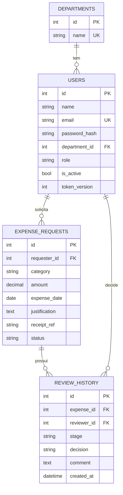

# NexusCorp — API de Gestão de Reembolsos

API REST em **Python (FastAPI + SQLAlchemy)** com banco relacional (**SQLite** por padrão; troque por PostgreSQL via `DATABASE_URL`). Autenticação por **JWT**, controle de acesso por perfil + escopo (dono / departamento) e máquina de estados para o fluxo de aprovação.

## Como executar

```bash
python -m venv .venv && source .venv/bin/activate      # Windows: .venv\Scripts\activate
pip install -r requirements.txt
python -m app.seed                  # cria departamentos e usuários de demonstração
python uvicorn app.main:app --reload       # docs interativas: http://127.0.0.1:8000/docs
python pytest -v                           # testes dos cenários 01–08 e das regras RN
python -m scripts.gerar_evidencias  # gera docs/EVIDENCIAS.md (requisições/respostas reais)
```

Usuários de demonstração (senha `Senha@123`, somente para teste): `ana@` (colaboradora, Comercial), `bruno@` (colaborador, Tecnologia), `patricia@` (gestora, Comercial), `carlos@` (gestor, Tecnologia), `fernando@` (gestor, Financeiro), `marina@` (financeiro) — todos `@nexuscorp.com`.
No Swagger (`/docs`): faça `POST /auth/login`, clique em **Authorize** e cole o `access_token`.

## 1. Descrição da solução

Camadas: `routers/` (HTTP) → `services.py` (regras de negócio e autorização por objeto) → `models.py` (SQLAlchemy). `workflow.py` é a máquina de estados pura; `schemas.py` define os contratos; `security.py`/`deps.py` cuidam de senha, JWT e perfis. Toda verificação acontece **antes** de qualquer escrita, então operação não autorizada não altera o banco.

## 2. Modelo de dados



Restrições no banco: FKs ativas (inclusive no SQLite), `UNIQUE(requester_id, receipt_ref)` (RN05), `CHECK(amount > 0)` (RN04), e-mail único.

## 3. Contrato das principais operações

Erros seguem `{"error": {"code": "...", "message": "..."}}` (422 inclui `details` por campo, sem ecoar valores enviados).

| Método e rota | Perfil | Sucesso | Erros principais |
|---|---|---|---|
| `POST /auth/register` `{name,email,password(≥8),department_id}` | público | 201 (sempre `colaborador`) | 409 e-mail duplicado · 422 |
| `POST /auth/login` `{email,password}` | público | 200 `{access_token,token_type,expires_in}` | 401 `credenciais_invalidas` |
| `POST /auth/logout` | autenticado | 204 (invalida todos os tokens) | 401 |
| `GET/PATCH /users/me` (PATCH só `name`) | autenticado | 200 | 401 · 422 se vier `role`/`department_id` |
| `GET /departments` | público (só id/nome) | 200 | — |
| `POST /expenses` `{category,amount,expense_date,justification,receipt_ref}` | autenticado | 201 (rascunho) | 409 `comprovante_duplicado` · 422 |
| `GET /expenses?status&category&limit&offset` | autenticado | 200 (só as **minhas**) | 401 |
| `GET /expenses/{id}` · `GET /expenses/{id}/history` | dono / gestor do depto / financeiro* | 200 | 404 se sem acesso |
| `PATCH /expenses/{id}` · `DELETE /expenses/{id}` | dono | 200 / 204 | 404 · 409 `solicitacao_nao_editavel` |
| `POST /expenses/{id}/submit` | dono | 200 → `aguardando_gestor` | 404 · 409 |
| `GET /manager/expenses?department_id&status&category` | gestor | 200 (só o seu depto) | 403 |
| `POST /manager/expenses/{id}/approve` `{comment?}` | gestor | 200 → `aguardando_financeiro` | 403 · 404 · 409 |
| `POST /manager/expenses/{id}/reject` `{comment}` | gestor | 200 → `recusada` | 422 sem justificativa |
| `GET /finance/expenses?department_id&status&category` | financeiro | 200 (já encaminhadas) | 403 |
| `POST /finance/expenses/{id}/approve` · `/reject` `{comment}` · `/pay` | financeiro | 200 → `aprovada` / `recusada` / `paga` | 403 · 404 · 409 `transicao_invalida` |

\* Financeiro só enxerga o que já chegou à sua etapa; gestor nunca vê rascunhos de terceiros.

**Códigos HTTP:** 401 = não identificado · 403 = perfil sem permissão / segregação de funções · 404 = recurso inexistente **ou de outro dono/departamento** (não revela existência) · 409 = violação de regra/estado (duplicidade, transição inválida, edição de solicitação enviada) · 422 = dados inválidos.

Estados: `rascunho → aguardando_gestor → aguardando_financeiro → aprovada → paga`; recusa possível nas duas etapas de análise (`recusada`). `paga` e `recusada` são finais.

## 4. Matriz de permissões

| Operação | Colaborador | Gestor | Financeiro |
|---|:-:|:-:|:-:|
| Registrar / editar (rascunho) / excluir (rascunho) / enviar **as próprias** | ✅ | ✅ | ✅ |
| Ver as próprias solicitações e histórico | ✅ | ✅ | ✅ |
| Ver solicitações de outros colaboradores | ❌ | só do **seu departamento** (exceto rascunhos) | só as **encaminhadas** (aguardando financeiro, aprovadas, pagas, recusadas por ele) |
| Aprovar/recusar na etapa do gestor | ❌ | ✅ só do seu depto, nunca a própria | ❌ |
| Aprovar/recusar na etapa financeira | ❌ | ❌ | ✅ nunca a própria |
| Registrar pagamento | ❌ | ❌ | ✅ (após aprovação financeira) |
| Alterar perfil/departamento | ❌ | ❌ | ❌ (só por seed/administração no banco) |

## 5. Regras de negócio implementadas

| Regra | Onde / como |
|---|---|
| RN01 | `deps.get_current_user` exige Bearer válido em tudo, exceto login, cadastro e lista de departamentos |
| RN02 | `services.can_view` / `_fetch_own`: 404 para objeto de terceiros |
| RN03 | gestor filtrado por `department_id` em listagem, detalhe e decisão |
| RN04 | `Money(gt=0, 2 casas)` no schema + `CHECK` no banco |
| RN05 | checagem em `_ensure_unique_receipt` + `UNIQUE` no banco (referência normalizada em maiúsculas) |
| RN06 | validador de data futura nos schemas |
| RN07 | `workflow.can_edit` (somente `rascunho`) em PATCH/DELETE |
| RN08 / RN10 | só existem as transições da tabela `workflow.TRANSITIONS`; o resto → 409 |
| RN09 | `services.manager_decide` / `finance_decide` → 403 `segregacao_de_funcoes` |
| RN11 | `RejectIn.comment` obrigatório (+ checagem no serviço) |
| RN12 | `review_history` grava responsável, etapa, decisão, observação e data a cada passo (inclusive o envio) |
| RN13 | senha com scrypt + salt; `UserOut` não tem campo de senha; 422 não ecoa o valor enviado |
| RN14 | JWT com `exp`; a cada request o usuário é relido do banco (ativo? `token_version` confere?); `/auth/logout` invalida tokens |
| RN15 | `extra="forbid"` nos schemas; cadastro força `colaborador`; `PATCH /users/me` só aceita `name` |

## 6. Decisões de segurança

- **Perfil e departamento nunca vêm do token nem do cliente**: o JWT guarda só `sub` e `ver`; o perfil é lido do banco a cada requisição (token forjado ou desatualizado não eleva privilégios).
- **Autorização em duas camadas**: perfil (`require_roles`) e objeto (dono/departamento) dentro de `services`.
- **Sem vazamento por erro**: login devolve a mesma resposta (e gasta o mesmo tempo) para e-mail inexistente ou senha errada; objetos de terceiros devolvem 404.
- **Anti mass-assignment**: campos extras são rejeitados (`status`, `requester_id`, `role`...). O solicitante vem da sessão.
- **Integridade sob concorrência**: a transição usa `UPDATE ... WHERE status = <atual>`; duas decisões simultâneas não passam ambas.
- **Segredos por ambiente** (`SECRET_KEY`, `DATABASE_URL`); `.env` e `*.db` fora do Git.

**Limitações assumidas (v1):** não há bloqueio/limitação de tentativas de login (recomendado: rate limit no gateway); não há perfil administrador, então perfis/departamentos de gestores e financeiro são definidos pelo seed ou direto no banco; uma solicitação de um gestor precisa ser aprovada por **outro** gestor do mesmo departamento (RN09); migrações com Alembic ficam para a v2 (as tabelas são criadas no startup).

## Estrutura

```
app/ (main, config, database, models, schemas, services, workflow, security, deps, errors, seed, routers/)
tests/ (cenários 01–08 e regras RN)   scripts/gerar_evidencias.py   docs/EVIDENCIAS.md (gerado)
```
